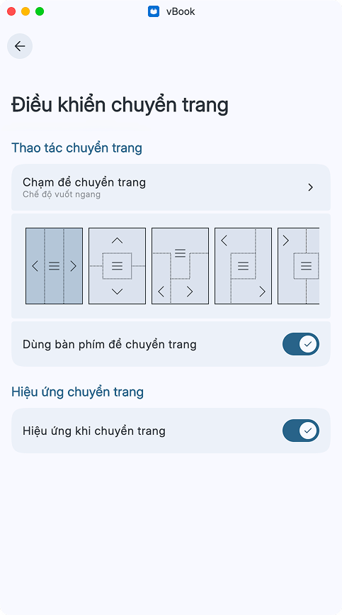
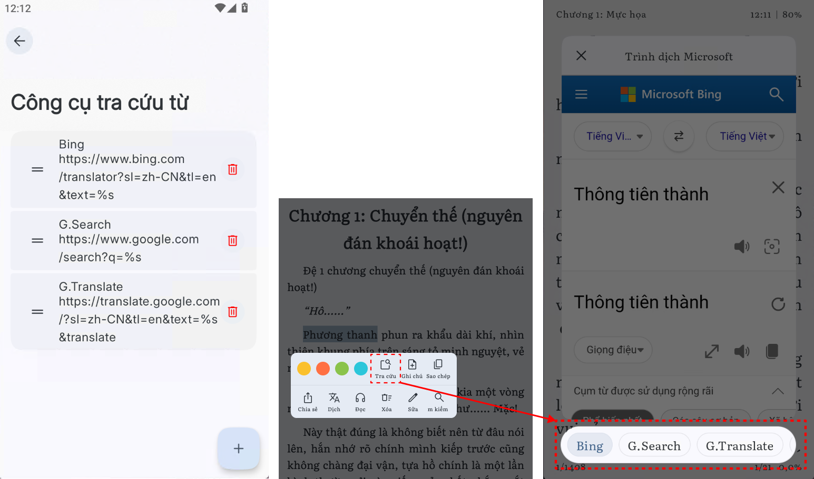
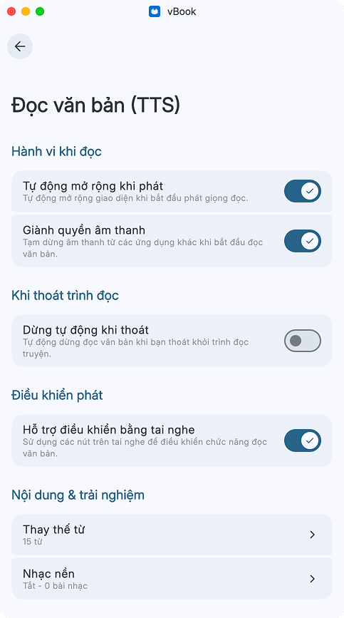
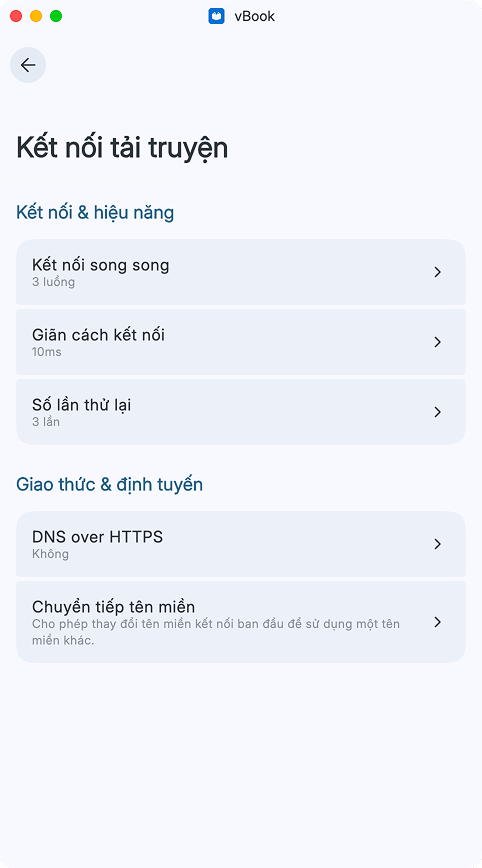

# Cài đặt đọc truyệnC

### Cài đặt đọc truyện

<figure><figcaption>
Toàn bộ cài đặt của phần đọc truyện
</figcaption></figure>

<figure><figcaption>
Các cài đặt của phần điều khiển chuyển trang
</figcaption></figure> <figure><figcaption>
Menu ngữ cảnh
</figcaption></figure>

### Công cụ tra cứu từ <mark style="background-color:yellow;">trong phần cài đặt đọc truyện</mark>

<figure><figcaption>
Công cụ tra cứu từ trong phần cài đặt đọc truyện và cách nó hiển thị trong app
</figcaption></figure>

### Nghe truyện bằng TTS

<figure><figcaption></figcaption></figure>

[<mark style="color:$primary;">**Các vấn đề liên quan đến TTS**</mark>](../../nghe-truyen/nghe-truyen-tts.md)

### Tự động dịch truyện

Dành cho ngôn ngữ không phải tiếng Việt

<figure><figcaption>
Các cài đặt trong phần dịch truyện
</figcaption></figure>

[<mark style="color:$primary;">**Các vấn đề và cài đặt liên quan đến dịch truyện**</mark>](../../truyen-chu/truyen-dich.md)

### Kết nối tải truyện

Tốc độ tải truyện chung

<figure><figcaption></figcaption></figure>
