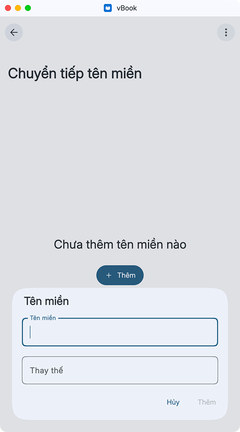

# Nguồn và tên miền

### Chuyển tiếp tên miền

Đổi tên miền mới: dành cho những trang web chỉ đổi tên miền nhưng không thay đổi cấu trúc web. Nhập tên miền cũ ở ô trên và tên miền mới ở ô dưới

<figure><figcaption></figcaption></figure>

### Nguồn và phần mở rộng

Để đọc truyện từ trang nguồn, hãy thêm nguồn phần mở rộng, sau đó cài phần mở rộng tương ứng với trang web bạn muốn sử dụng.

<a href="https://app.gitbook.com/s/wIrVteEIDLZ8Ul4z69Rr/nguon-mo-rong" class="button primary">Danh sách nguồn</a>
