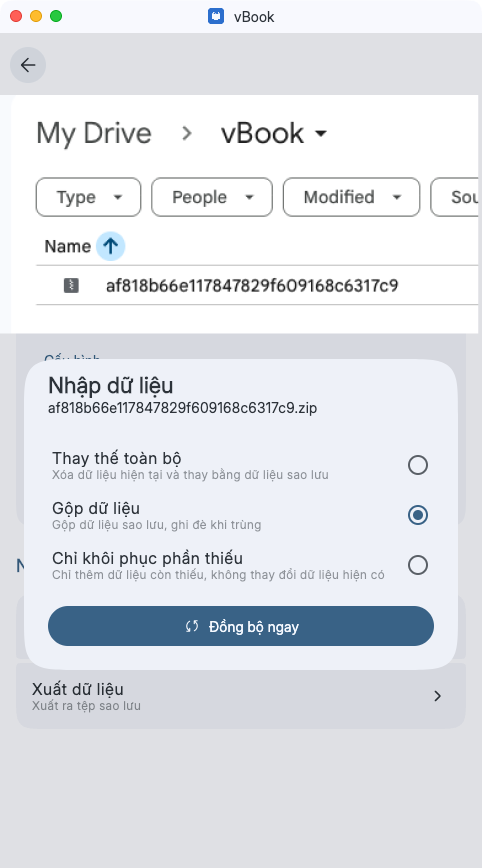
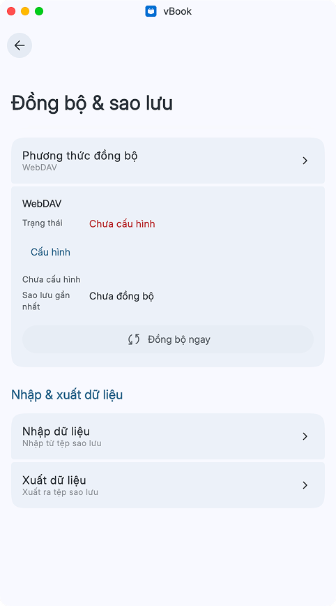
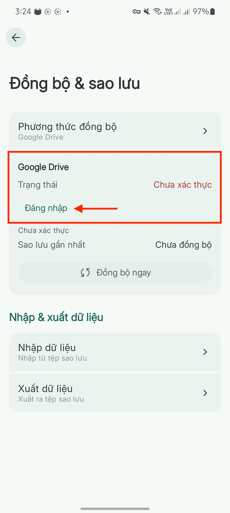

# Sao lưu và đồng bộ

### Nhập dữ liệu từ vbook bản thường qua vbook bản beta

Quá trình này sẽ sao lưu và phục hồi toàn bộ dữ liệu của app (tiến trình đọc, danh sách truyện trong kệ sách, ext đã cài qua file zip và qua nguồn, dữ liệu vietphrase chung và riêng) nhưng <mark style="color:$danger;background-color:yellow;">không bao gồm dữ liệu từ điển, nội dung truyện đã tải, truyện nhập qua file và danh sách các repo nguồn</mark>

1. Đồng bộ dữ liệu bản thường lên Drive
2. Lên Drive vào thư mục vBook, **tải bản zip vừa đồng bộ về điện thoại**
3. Mở bản beta lên, vào mục **Đồng bộ và Sao lưu > Nhập và xuất dữ liệu,** chọn **Nhập dữ liệu**, nhập file zip vừa tải về.

<figure><figcaption></figcaption></figure> <figure><figcaption></figcaption></figure>

### Đồng bộ giữa nhiều thiết bị (bản beta)

### Google Drive

* Phương thức đồng bộ: Chọn Google Drive
* Chọn Đăng nhập

<figure><figcaption></figcaption></figure>

[Xem hướng dẫn thiết lập WebDAV trên Cloudflare.](webdav-cloudflare.md)
