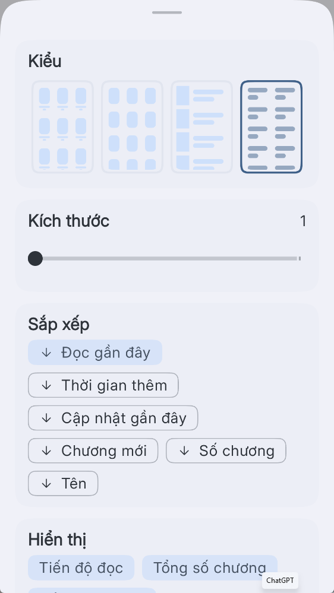
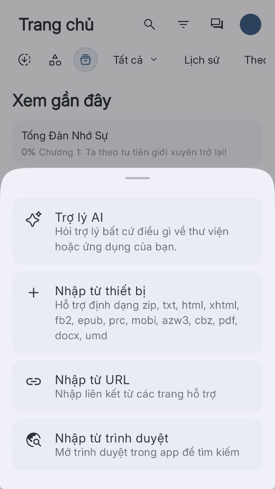
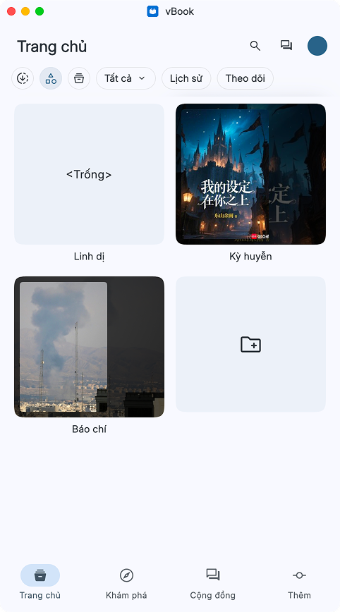
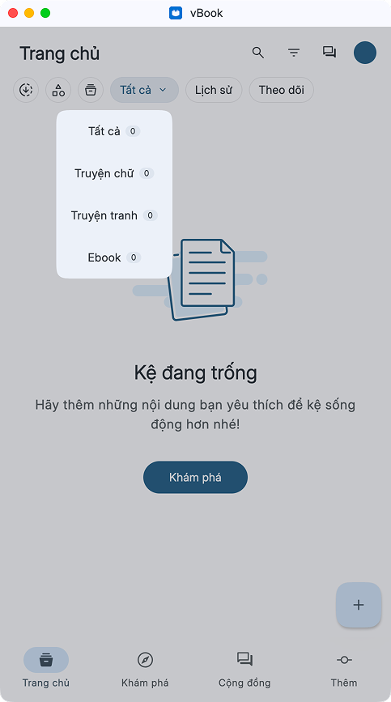
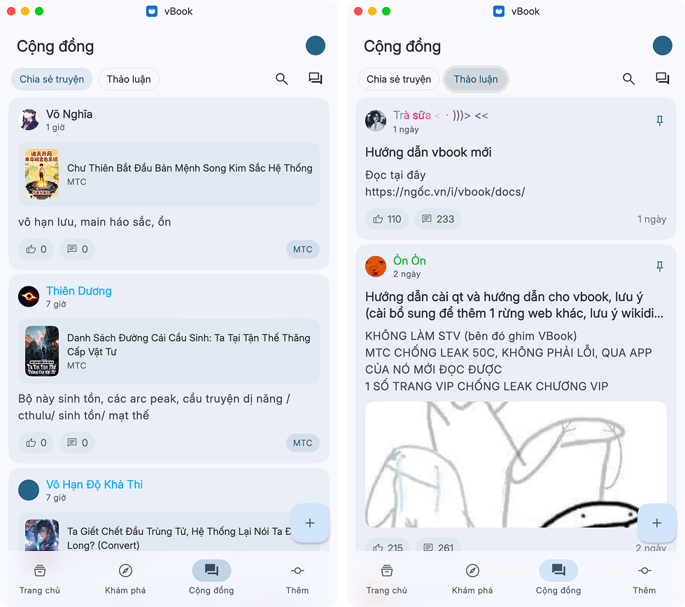
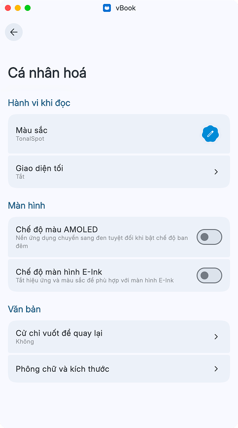
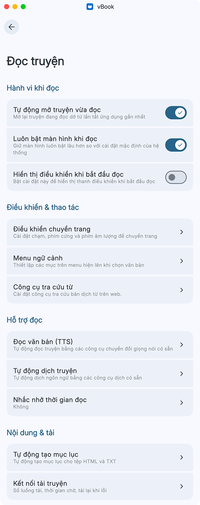
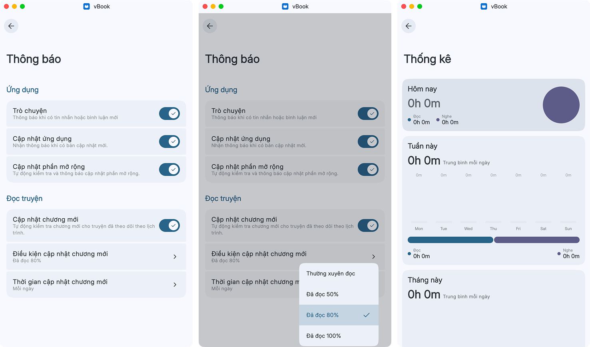

# Làm quen với giao diện

Trang này giới thiệu các khu vực chính của vBook để bạn biết nơi tìm truyện, quản lý kệ sách và mở cài đặt. Bạn có thể xem video tổng quan hoặc theo dõi các hình minh họa bên dưới.

## Video giới thiệu

{% embed url="https://files.gitbook.com/v0/b/gitbook-x-prod.appspot.com/o/spaces%2FwIrVteEIDLZ8Ul4z69Rr%2Fuploads%2FRP6Z8A6VROAMeRel6aYY%2F1.mp4?alt=media&token=8be7bf88-674f-4b1a-b3fc-fbb35e42ee36" %}

## Hình ảnh

<figure><figcaption><p>Ảnh 1. Màn hình trang chủ và các khu vực chính</p></figcaption></figure>

### Thanh công cụ phía trên

* Tìm kiếm: tìm truyện trong kệ sách.
* Bộ lọc: tùy chỉnh cách sắp xếp và hiển thị truyện (Ảnh 2).
* Chat: mở nhóm trò chuyện chung trong ứng dụng.
* Ảnh đại diện: nhấn để mở menu tài khoản.

### Các mục trong kệ sách

* Tải xuống: xem danh sách truyện đang tải hoặc đã tải.
* Thư viện: quản lý truyện theo danh mục bạn tự tạo, chẳng hạn Ngôn tình hoặc Huyền huyễn (Ảnh 4).\
  _<mark style="color:$warning;">Lưu ý: tạo danh mục trước, sau đó thêm truyện vào danh mục đó.</mark>_
* Tất cả: xem kệ sách chính và các nhóm truyện tranh, truyện chữ, ebook (Ảnh 5).
* Lịch sử: xem danh sách truyện đã đọc.
* Theo dõi: xem danh sách truyện bạn đã chọn theo dõi.

### Nhập truyện

* Nhập từ file: thêm truyện từ tệp trên thiết bị. Các định dạng được hỗ trợ hiển thị trong menu nhập truyện (Ảnh 3).
* Nhập từ URL hoặc trình duyệt: áp dụng cho trang web có phần mở rộng tương ứng.

### Thanh điều hướng chính

* Trang chủ
* Khám phá: duyệt các trang truyện ngay trong vBook.
* Cộng đồng: chia sẻ đánh giá truyện, trò chuyện, hỏi đáp và báo lỗi.
* Thêm: truy cập các cài đặt của ứng dụng.

<figure><figcaption><p>Ảnh 2. Bộ lọc và tùy chọn sắp xếp truyện</p></figcaption></figure>

<figure><figcaption><p>Ảnh 3. Các cách nhập truyện</p></figcaption></figure>

<div><figure><figcaption><p>Ảnh 4. Danh mục trong thư viện</p></figcaption></figure> <figure><figcaption><p>Ảnh 5. Các nhóm truyện trong kệ sách</p></figcaption></figure></div>

<figure><figcaption><p>Khu vực cộng đồng</p></figcaption></figure>

<figure><figcaption><p>Các mục cài đặt của ứng dụng</p></figcaption></figure>

## Cài đặt

1. Cá nhân hóa: tùy chỉnh giao diện ứng dụng. [Xem cài đặt giao diện](lam-quen-voi-giao-dien.md#cai-dat-giao-dien)
2. Ngôn ngữ: thay đổi ngôn ngữ hiển thị của ứng dụng.
3. Đọc truyện: tùy chỉnh các thiết lập khi đọc. [Xem cài đặt đọc truyện](lam-quen-voi-giao-dien.md#cai-dat-doc-truyen)
4. Thông báo: tùy chỉnh thông báo trò chuyện và cập nhật chương mới. [Xem thông báo và thống kê](lam-quen-voi-giao-dien.md#thong-bao-va-thong-ke)
5. Thống kê: xem thời gian đọc và dung lượng ứng dụng đang sử dụng. [Xem thông báo và thống kê](lam-quen-voi-giao-dien.md#thong-bao-va-thong-ke)
6. Phần mở rộng: [Hướng dẫn](https://app.gitbook.com/s/wIrVteEIDLZ8Ul4z69Rr/nguon-mo-rong)
7. Trình duyệt: Các cài đặt liên quan trang nguồn vbook
8. Đồng bộ và Sao lưu [Xem sao lưu và đồng bộ](lam-quen-voi-giao-dien.md#sao-luu-va-dong-bo)
9. Trợ giúp
10. Phản hồi: Báo lỗi liên quan vbook và phần mở rộng
11. Điều khoản sử dụng
12. Chính sách bảo mật
13. Kiểm tra bản cập nhật
14. Phiên bản ứng dụng: nhấn 7 lần để mở dev mode

### Cài đặt giao diện

<figure><figcaption></figcaption></figure>

### Cài đặt đọc truyện

<figure><figcaption><p>Toàn bộ cài đặt của phần đọc truyện</p></figcaption></figure>

<div><figure><figcaption><p>Các cài đặt của phần điều khiển chuyển trang</p></figcaption></figure> <figure><figcaption><p>Menu ngữ cảnh</p></figcaption></figure></div>

#### Công cụ tra cứu từ <mark style="background-color:yellow;">trong phần cài đặt đọc truyện</mark>

<figure><figcaption><p>Công cụ tra cứu từ trong phần cài đặt đọc truyện và cách nó hiển thị trong app</p></figcaption></figure>

### Nghe truyện (Text-to-speech)

<figure><figcaption></figcaption></figure>

[<mark style="color:$primary;">**Các vấn đề liên quan đến TTS**</mark>](../nghe-truyen/nghe-truyen-tts.md)

### Tự động dịch truyện

Dành cho ngôn ngữ không phải tiếng Việt

<figure><figcaption><p>Các cài đặt trong phần dịch truyện</p></figcaption></figure>

[<mark style="color:$primary;">**Các vấn đề và cài đặt liên quan đến dịch truyện**</mark>](../truyen-chu/truyen-dich.md)

### Kết nối tải truyện

Tốc độ tải truyện chung

<figure><figcaption></figcaption></figure>

### Chuyển tiếp tên miền

Đổi tên miền mới: dành cho những trang web chỉ đổi tên miền nhưng không thay đổi cấu trúc web. Nhập tên miền cũ ở ô trên và tên miền mới ở ô dưới

<figure><figcaption></figcaption></figure>

### Phần mở rộng

Cần cài đặt nguồn, sau đó cài đặt ext mới có thể đọc truyện trên vbook được

<a href="https://app.gitbook.com/s/wIrVteEIDLZ8Ul4z69Rr/nguon-mo-rong" class="button primary">Danh sách nguồn</a>

### Thông báo và thống kê

<figure><figcaption></figcaption></figure>

### Sao lưu và đồng bộ

#### Nhập dữ liệu từ vbook bản thường qua vbook bản beta

Quá trình này sẽ sao lưu và phục hồi toàn bộ dữ liệu của app (tiến trình đọc, danh sách truyện trong kệ sách, ext đã cài qua file zip và qua nguồn, dữ liệu vietphrase chung và riêng) nhưng <mark style="color:$danger;background-color:yellow;">không bao gồm dữ liệu từ điển, nội dung truyện đã tải, truyện nhập qua file và danh sách các repo nguồn</mark>

1. Đồng bộ dữ liệu bản thường lên Drive
2. Lên Drive vào thư mục vBook, **tải bản zip vừa đồng bộ về điện thoại**
3. Mở bản beta lên, vào mục **Đồng bộ và Sao lưu > Nhập và xuất dữ liệu,** chọn **Nhập dữ liệu**, nhập file zip vừa tải về.

<div><figure><figcaption></figcaption></figure> <figure><figcaption></figcaption></figure></div>

#### Sao lưu và Đồng bộ giữa nhiều thiết bị <mark style="color:$danger;">(bản beta)</mark>

#### 1. Google Drive

* Phương thức đồng bộ: Chọn Google Drive
* Chọn Đăng nhập

<figure><figcaption></figcaption></figure>

#### 2. WebDAV



### Yêu cầu chuẩn bị:&#x20;

Bạn cần đăng ký một tài khoản Cloudflare



### Kích hoạt R2

1. Vào [https://dash.cloudflare.com/cde4cec05bc9e288705067620b6a7fcf/r2/plans](https://dash.cloudflare.com/cde4cec05bc9e288705067620b6a7fcf/r2/plans)
2.  Chọn <mark style="color:$primary;">**Add R2 subscription to my account**</mark> và điền các thông tin liên quan


    <figure><figcaption></figcaption></figure>



### Cấu hình Cloudflare

1.  Vào **Cloudflare Dashboard,** mục **R2** và **tạo một Bucket mới** (**ví dụ: vbook-backup-bucket)**: [https://dash.cloudflare.com/08a1ed706f082c8a00f1918888d0585b/r2/overview](https://dash.cloudflare.com/08a1ed706f082c8a00f1918888d0585b/r2/overview)


    <figure><figcaption></figcaption></figure>
2.  Vào **Workers & Pages > KV** và tạo một Namespace mới (ví dụ: USER\_KV). **Copy ID của Namespace đó.**\
    [https://dash.cloudflare.com/08a1ed706f082c8a00f1918888d0585b/workers/kv/namespaces](https://dash.cloudflare.com/08a1ed706f082c8a00f1918888d0585b/workers/kv/namespaces)


    <figure><figcaption></figcaption></figure>


    <figure><figcaption></figcaption></figure>



### Cài đặt dự án

* Cài Node


```
node -v
npm -v
```


* Cài Wrangler CLI


```
npm install -g wrangler
```


* Tải dự án về máy tính của bạn


```
git clone https://github.com/kychitoge/vbook-webdav.git
cd vbook-webdav
npm install
```




### Cấu hình Biến môi trường

Đổi tên file `wrangler.example.jsonc` thành `wrangler.jsonc` ở thư mục gốc và cập nhật thông tin của bạn

<figure><figcaption></figcaption></figure>



### Deploy lên Cloudflare


```
npx wrangler deploy
```




### Hướng Dẫn Sử Dụng

1. **Quản trị User (Dành cho Admin)**
   1. Truy cập đường dẫn bí mật: `https://<ten-worker>.<tài khoản cloudflare của bạn>.workers.dev/admin`
   2. Nhập mã PIN (Đã cài trong phần ADMIN\_PIN)
   3. Thêm Username mới, thiết lập Mật khẩu, Dung lượng tối đa (Quota MB), Kích thước file tối đa (Max File MB).
   4.  Bấm Edit để cập nhật thông số người dùng hiện tại (bỏ trống trường password để giữ nguyên mật khẩu cũ) hoặc Delete để xóa người dùng cùng toàn bộ file R2 của người dùng đó.


       <figure><figcaption></figcaption></figure>
2. **Cấu hình trên Ứng dụng VBook / Legado**
   1. Mở ứng dụng đọc truyện của bạn, vào phần **Đồng bộ & Sao lưu -> WebDAV**
   2. **URL / Địa chỉ:** `https://<ten-worker>.<tài khoản cloudflare của bạn>.workers.dev/` (Hoặc có thể thêm `/webdav` phía sau đều được hỗ trợ).
   3. **Tên đăng nhập (Username):** Username vừa tạo trong trang Admin.
   4. **Mật khẩu (Password):** Mật khẩu tương ứng vừa tạo trong trang Admin.
   5. **Thư mục gốc:&#x20;**<mark style="color:red;">**`vbook_backup`**</mark> (Khuyến nghị giữ nguyên để tạo thư mục đồng bộ riêng).
   6. Bấm **Kiểm tra** để xác thực kết nối (thấy chữ xanh báo thành công) và bấm **Lưu lại**!



### Giao diện Web Cá Nhân (Fake Cloud Drive)

* Mở trình duyệt truy cập thẳng: `https://<ten-worker>.<tài khoản cloudflare của bạn>.workers.dev/`
* Hệ thống sẽ hỏi thông tin đăng nhập **Basic Auth**.
* Nhập tài khoản người dùng WebDAV của bạn (đã tạo trong trang Admin).
* Bạn có thể xem trực quan danh sách file, kiểm tra dung lượng còn trống, tải file về máy hoặc xóa file cực kỳ thuận tiện.
* Có thể chia sẻ/dùng chung webdav bằng cách tạo new user.

<figure><figcaption></figcaption></figure>



### Lưu Ý Về Giới Hạn Vật Lý (Hạ Tầng Cloudflare)

Vì hệ thống vận hành trên kiến trúc Serverless miễn phí của Cloudflare, có một số giới hạn vật lý cần chú ý:

1. <mark style="color:$danger;">**Giới hạn dung lượng file tải lên tối đa là 100MB:**</mark> Cloudflare Workers giới hạn dung lượng request tối đa là **100MB**. Nếu bạn tải lên file đơn lẻ nặng hơn 100MB, Cloudflare Edge sẽ trả về lỗi <mark style="color:$danger;">`413 Request Entity Too Large`</mark> trước khi Worker kịp xử lý. Hãy thiết lập WebDAV client chia nhỏ file nếu bạn cần backup khối lượng dữ liệu khổng lồ.
2. **Đồng bộ KV (Eventual Consistency):** Workers KV có cơ chế đồng bộ phân tán toàn cầu với độ trễ từ 1-5 giây. Vì vậy, dung lượng lưu trữ trên trang Admin hoặc Web UI có thể mất vài giây để cập nhật chính xác số bytes sau khi bạn vừa tải một lượng lớn file lên.
3. **Bắt buộc sử dụng HTTPS:** Xác thực Basic Auth gửi mật khẩu dưới dạng chuỗi Base64. Luôn đảm bảo sử dụng đường dẫn `https://` (mặc định Cloudflare đã kích hoạt sẵn) để đảm bảo mật khẩu được truyền đi qua kênh mã hóa an toàn.



### Chế độ nhà phát triển

Dành cho nhà phát triển.

<figure><figcaption></figcaption></figure>
