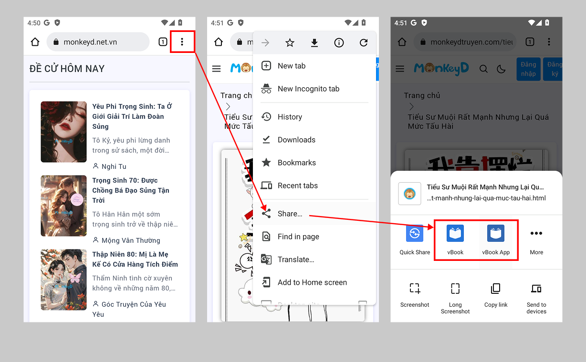
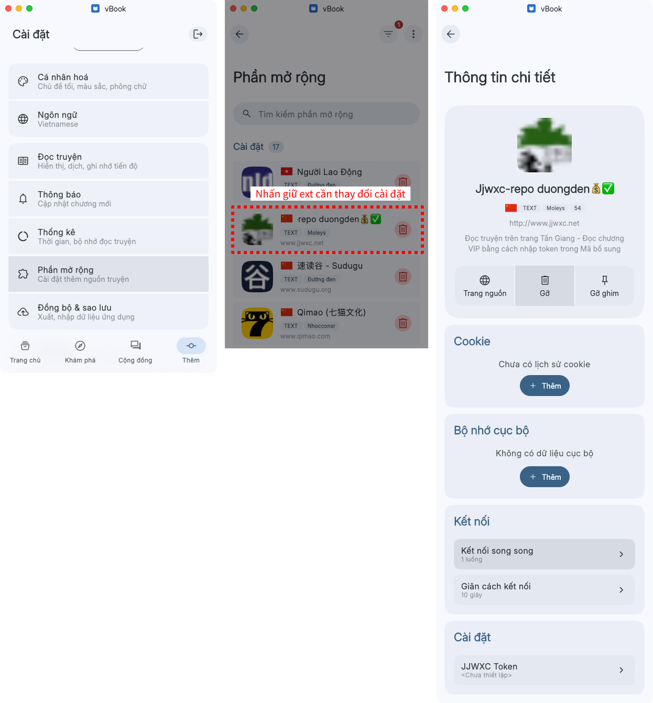

# Thêm truyện và quản lý nội dung

## Thêm truyện từ trình duyệt

<figure><figcaption></figcaption></figure>

## Thêm truyện từ trang nguồn

<figure><figcaption></figcaption></figure>

## Mở cài đặt riêng cho một nguồn

<figure><figcaption></figcaption></figure>

## Xóa cache/nội dung chương đã tải

{% embed url="https://files.gitbook.com/v0/b/gitbook-x-prod.appspot.com/o/spaces%2FwIrVteEIDLZ8Ul4z69Rr%2Fuploads%2F7D4Qktp6qTdbkkKV7YdR%2FVideo_2026-10-11_141851.mp4?alt=media&token=ed68de86-5249-408b-8572-d52740a69219" %}

## Sửa tên truyện nguồn Việt

1.  Đánh dấu từ cần sửa, chọn Sửa tên

    <figure><figcaption>
Bản thường
</figcaption></figure>

    <figure><figcaption>
Bản beta
</figcaption></figure>
2. Thêm vào Name chung: tức là sẽ áp dụng thay đổi cho tất cả các truyện trong kệ sách
   *   **Cc (bản thường) Aa (bản beta):** là chức năng sửa sẽ áp dụng cho cả chữ viết hoa lẫn viết thường.

       Ví dụ: sửa "Bệnh Viện" thành "bệnh viện"
   * Khi không chọn **Cc/Aa**: chỉ sửa đúng cụm "Bệnh Viện" thành "bệnh viện". Các cụm viết "Bệnh viện" hay "bệnh Viện" sẽ không thay đổi.
   * Khi chọn **Cc/Aa**: tất cả các cụm "Bệnh Viện", "Bệnh viện" hay "bệnh Viện" sẽ được thay đổi thành "bệnh viện"

